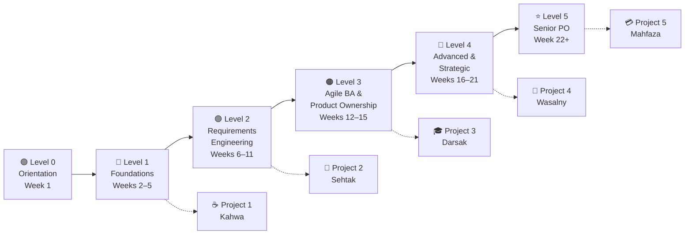
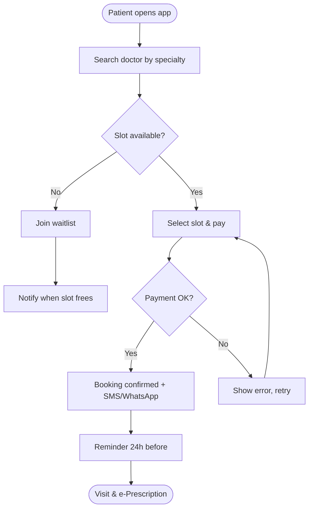
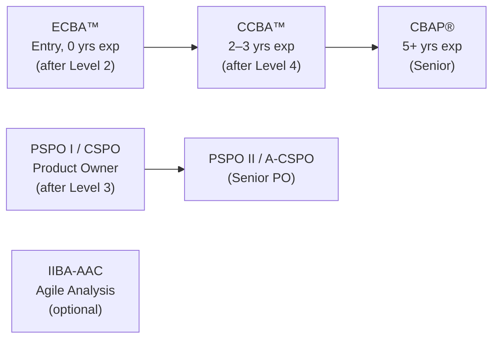

# 🧭 To Be a Senior Product Owner
### The Business Analysis → Product Ownership Roadmap (Zero to Senior)

> **من الصفر لحد ما تبقى Senior Product Owner** — a practical, project-based roadmap for anyone starting the Business Analysis track, built around real deliverables (BRD, SRS, User Stories, BPMN flows, Backlogs, Roadmaps), not just videos.

   

---

## 📑 Table of Contents

1. [Who Is This For?](#-who-is-this-for)
2. [How to Use This Roadmap](#-how-to-use-this-roadmap)
3. [The Big Picture](#-the-big-picture)
4. [Core Resources (The Library)](#-core-resources-the-library)
5. [Level 0 — Orientation](#level-0--orientation-week-1)
6. [Level 1 — Foundations](#level-1--foundations-weeks-25)
7. [Level 2 — Requirements Engineering](#level-2--requirements-engineering-weeks-611)
8. [Level 3 — Agile BA & Product Ownership](#level-3--agile-ba--product-ownership-weeks-1215)
9. [Level 4 — Advanced & Strategic Analysis](#level-4--advanced--strategic-analysis-weeks-1621)
10. [Level 5 — Senior Product Owner](#level-5--senior-product-owner-weeks-22-ongoing)
11. [Practice Projects (Fake Clients, Real Deliverables)](#-practice-projects-fake-clients-real-deliverables)
12. [Templates Toolkit](#-templates-toolkit)
13. [Arabic & Egyptian Content](#-arabic--egyptian-content)
14. [Tools You Must Know](#-tools-you-must-know)
15. [Certification Path](#-certification-path)
16. [Portfolio & Job Readiness](#-portfolio--job-readiness)
17. [Progress Tracker](#-progress-tracker)
18. [Contributing](#-contributing)

---

## 👥 Who Is This For?

| You are… | Start at |
|---|---|
| A fresh graduate (any major) curious about BA / PO | **Level 0** |
| A developer, tester, or designer moving into BA | **Level 1** (skim Level 0) |
| A junior BA who writes requirements but feels "unstructured" | **Level 2** |
| A BA working in Scrum teams who wants to become a PO | **Level 3** |
| A mid-level BA/PO preparing for CCBA/CBAP or a senior role | **Level 4 → 5** |

---

## 🛠 How to Use This Roadmap

1. **Fork this repo** and create a folder `submissions/<your-name>/`.
2. Follow the levels in order. Each level has:
   - 🎯 **Goals:** what you should be able to do at the end
   - 📚 **Learn:** the resources, in order
   - 🧪 **Practice:** tasks on a fictional project
   - ✅ **Exit Criteria:** you don't move to the next level until you can tick all of them
3. Commit every deliverable (BRD, SRS, diagrams, backlog exports) to your fork. **Your fork becomes your portfolio.**
4. Ask a peer or mentor to review your work against the acceptance criteria in each task. Reviewing is half the learning.

> 💡 **The 30/70 rule:** spend 30% of your time watching and reading, and 70% producing documents. A BA is judged by their artifacts, not by their certificates.

**Suggested weekly rhythm (10–12 hrs/week):**

| Day | Activity | Time |
|---|---|---|
| Sat | Course / video lessons | 3 h |
| Sun | Book reading + notes | 2 h |
| Mon–Wed | Practice task on the level project | 4–5 h |
| Thu | Peer review + fix feedback | 1–2 h |
| Fri | Rest / community / LinkedIn post about what you learned | — |

---

## 🗺 The Big Picture



| Level | Title | You become able to… | Main Deliverable |
|---|---|---|---|
| 0 | Orientation | Explain what a BA / PO does and how software is built | Career map + glossary |
| 1 | Foundations | Understand the business problem, stakeholders and processes | Vision & Scope + AS-IS/TO-BE flows |
| 2 | Requirements Engineering | Elicit, analyze, document and validate requirements | **BRD + SRS + Use Cases + BPMN + RTM** |
| 3 | Agile BA & PO | Turn requirements into a living, prioritized backlog | **Epics, User Stories, AC, Story Map, Sprint Plan** |
| 4 | Advanced & Strategic | Justify investments and evaluate solutions | Business Case, Gap Analysis, KPIs, Risk Register |
| 5 | Senior PO | Own product strategy, outcomes and teams | Product Vision, Roadmap, OKRs, PRD |

---

## 📚 Core Resources (The Library)

These are the **core resources** of this roadmap. Each one is mapped to the level where it fits best.

| # | Resource | Type | Provider | Used in Level |
|---|---|---|---|---|
| R1 | [Business Analysis Foundations](https://www.linkedin.com/learning/search?keywords=Business%20Analysis%20Foundations) | Course | LinkedIn Learning | **1** |
| R2 | [Software Development Lifecycle Specialization](https://www.coursera.org/specializations/software-development-lifecycle) | Course (4 courses) | Coursera — University of Minnesota | **1 → 3** |
| R3 | [Software Requirements, 3rd Edition](https://www.processimpact.com/) — Karl Wiegers & Joy Beatty | Book | Microsoft Press | **2** (the "bible" of requirements) |
| R4 | [Business Analysis for Practitioners: A Practice Guide](https://www.pmi.org/pmbok-guide-standards/practice-guides) | Book / Guide | Project Management Institute (PMI) | **2 → 4** |
| R5 | [Agile Requirements Foundations](https://www.linkedin.com/learning/search?keywords=Agile%20Requirements%20Foundations) | Course | LinkedIn Learning | **3** |
| R6 | [BABOK Guide v3](https://www.iiba.org/career-resources/a-business-analysis-professionals-foundation-for-success/babok/) | Standard / Book | IIBA | **2 → 4** (reference all the way) |
| R7 | [CBAP — Certified Business Analysis Professional prep](https://www.udemy.com/courses/search/?q=CBAP) | Course | Udemy | **4** |
| R8 | [PMBOK® Guide — 8th Edition](https://www.pmi.org/pmbok-guide-standards/foundational/pmbok) | Standard / Book | PMI | **4 → 5** (value delivery, stakeholders, tailoring) |

### ➕ Recommended Additions (Senior PO picks)

| Resource | Why it's here | Level |
|---|---|---|
| [The Scrum Guide](https://scrumguides.org/) (free, available in **Arabic**) | 13 pages. The official definition of the PO role. Read it 3 times. | 1 & 3 |
| *User Story Mapping* — Jeff Patton | The best book on slicing a product into releases | 3 |
| *Writing Effective Use Cases* — Alistair Cockburn | Deep dive into use case specifications | 2 |
| *Software Requirements Essentials* — Wiegers & Hokanson (2023) | A short, modern summary of R3, good for revision | 2 |
| *Business Analysis Techniques* — Cadle, Paul & Turner | 123 techniques with practical examples | 4 |
| *Inspired* — Marty Cagan | How strong product teams work | 5 |
| *Continuous Discovery Habits* — Teresa Torres | Customer interviews and opportunity trees | 5 |
| [roadmap.sh — Product Manager](https://roadmap.sh/product-manager) | Visual roadmap to cross-check the PO skills in Level 5 | 5 |
| [Agile Alliance Glossary](https://www.agilealliance.org/agile101/agile-glossary/) | Quick definitions of every Agile term | 3 |

---

## Level 0 — Orientation (Week 1)

### 🎯 Goals
- Understand the difference between **Business Analyst, Product Owner, Product Manager, Project Manager, Systems Analyst and Scrum Master**.
- Understand how a software product moves from an idea to production.
- Build your BA vocabulary.

### 📚 Learn
1. Watch an introductory Arabic video (see [Arabic & Egyptian Content](#-arabic--egyptian-content)).
2. Read the [Scrum Guide](https://scrumguides.org/) once, in Arabic or English.
3. Read the BABOK v3 **Chapter 1 (Introduction)** and **Chapter 2 (Business Analysis Key Concepts)**: the *BACCM™* (Change, Need, Solution, Stakeholder, Value, Context).

### 🧪 Practice
| # | Task | Deliverable |
|---|---|---|
| 0.1 | Make a comparison table of the 6 roles above: responsibilities, main artifacts, who they talk to daily | `roles-comparison.md` |
| 0.2 | Create your **BA Glossary** of 40 terms (requirement, stakeholder, scope, MVP, backlog, AC, NFR, BPMN, UAT…), in English plus a short Arabic explanation | `glossary.md` |
| 0.3 | Pick an app you use daily (Talabat, InstaPay, Vezeeta…) and write **one page**: who are its users, what problem does it solve, how does it make money? | `app-teardown.md` |

### ✅ Exit Criteria
- [ ] I can explain BA vs PO in 60 seconds.
- [ ] I can name the 6 core concepts of the BACCM.
- [ ] My glossary has ≥ 40 terms.

---

## Level 1 — Foundations (Weeks 2–5)

### 🎯 Goals
- Understand the BA role, mindset and the core activities: **elicit → analyze → document → validate → manage**.
- Understand SDLC models: Waterfall, V-Model, Iterative, Agile (Scrum/Kanban).
- Identify stakeholders, define the problem and draw business processes.

### 📚 Learn
| Order | Resource | Focus |
|---|---|---|
| 1 | **R1 — Business Analysis Foundations** (LinkedIn Learning) | BA role, core activities, stakeholder basics |
| 2 | **R2 — SDLC Specialization**, Course 1 (Coursera) | SDLC models, the phases of software development |
| 3 | **R6 — BABOK v3**, Ch. 3 *Business Analysis Planning & Monitoring* (overview only) | How a BA plans their work |
| 4 | BPMN 2.0 basics (any free tutorial plus [bpmn.io](https://bpmn.io/)) | Events, tasks, gateways, swimlanes |

### 🧠 Key concepts checklist
`Problem statement` · `Business need vs. solution` · `Stakeholder map (Power/Interest grid)` · `RACI` · `AS-IS vs TO-BE` · `SIPOC` · `BPMN: pool, lane, gateway, event` · `Scope (in/out)` · `Assumptions, Constraints, Dependencies, Risks`

### 🧪 Practice — ☕ [Project 1: Kahwa](#-project-1--kahwa-café-pre-order-app)
| # | Task | Deliverable | Acceptance Criteria |
|---|---|---|---|
| 1.1 | Write the **Problem Statement** using the template *"The problem of… affects… the impact is… a successful solution would…"* | `01-problem-statement.md` | (1) 1 paragraph, ≤ 120 words • (2) Contains at least one measurable impact • (3) No solution mentioned inside the problem |
| 1.2 | Build a **Stakeholder Register** + Power/Interest grid | `02-stakeholders.md` | (1) ≥ 6 stakeholders • (2) Each has role, interest, influence, communication method • (3) Grid diagram included |
| 1.3 | Draw the **AS-IS process** (how ordering works today) in BPMN | `03-as-is.bpmn` + PNG | (1) Uses pools/lanes • (2) At least 1 gateway • (3) Pain points marked in red |
| 1.4 | Draw the **TO-BE process** with the app | `04-to-be.bpmn` + PNG | (1) Every pain point from 1.3 is solved or explained • (2) Start and end events are clear |
| 1.5 | Write a **Vision & Scope document** (2–3 pages) | `05-vision-scope.md` | (1) Vision statement • (2) In-scope / Out-of-scope lists • (3) Assumptions, constraints, risks • (4) Success metrics |

### ✅ Exit Criteria
- [ ] I can tell a **need** from a **solution**.
- [ ] I can draw a correct BPMN flow with lanes and gateways.
- [ ] My Vision & Scope was reviewed by a peer and the feedback was fixed.

---

## Level 2 — Requirements Engineering (Weeks 6–11)

> 🔥 **The most important level.** This is where you learn to write the **BRD** and the **SRS**, the documents every company will ask you to show.

### 🎯 Goals
- Run elicitation: interviews, workshops, observation, document analysis, surveys and prototyping.
- Classify requirements: **Business → Stakeholder/User → Solution (Functional + Non-Functional) → Transition**. These are the BABOK requirement types.
- Write a professional **BRD** and **SRS** (ISO/IEC/IEEE 29148 structure).
- Model with **Use Cases, BPMN, Activity diagrams, ERD/Data Dictionary, Wireframes**.
- Validate requirements and trace them with an **RTM**.

### 📚 Learn
| Order | Resource | Focus |
|---|---|---|
| 1 | **R3 — Wiegers, *Software Requirements* 3rd ed.**: Part I (Ch. 1–4) and Part II (Ch. 5–17) | Requirement levels, elicitation, documenting, prioritizing, validating |
| 2 | **R6 — BABOK v3**, Ch. 4 *Elicitation & Collaboration* and Ch. 7 *Requirements Analysis & Design Definition* | The formal knowledge areas |
| 3 | **R4 — PMI Business Analysis for Practitioners**, the *Elicitation* and *Analysis* sections | A practical view of the same topics |
| 4 | **R2 — SDLC Specialization**, the requirements course | Requirements inside the SDLC |
| 5 | Video: [BRD vs SRS — Techcanvass](https://www.youtube.com/watch?v=9Mhmq26IguM) | The difference in 10 minutes |

### 🧠 BRD vs FRD vs SRS (know this cold)

| | **BRD** — Business Requirements Document | **FRD** — Functional Requirements Document | **SRS** — Software Requirements Specification |
|---|---|---|---|
| Answers | **Why** and **What** does the business need? | **What** must the system do? | **What and how well** must the software do it, in precise and testable terms? |
| Audience | Sponsors, business stakeholders | BA, PO, dev leads | Developers, QA, architects |
| Language | Business language | Functional language | Technical and precise |
| Contains | Objectives, scope, business rules, high-level requirements, process flows | Detailed functional requirements, use cases | Functional + non-functional requirements, interfaces, data, constraints |
| Owner | BA | BA | BA / Systems Analyst |

### 🧪 Practice — 🏥 [Project 2: Sehtak](#-project-2--sehtak-clinic-booking--e-prescription)
| # | Task | Deliverable | Acceptance Criteria |
|---|---|---|---|
| 2.1 | Prepare an **interview plan + question list** for 3 stakeholders (doctor, receptionist, patient) | `01-elicitation-plan.md` | (1) Objective per interview • (2) ≥ 10 open-ended questions each • (3) No leading questions |
| 2.2 | Run a **mock interview** with a friend playing the role (use the persona cards) and write the **meeting minutes** | `02-interview-notes.md` | (1) Date, attendees, decisions, open questions, action items • (2) Raw notes separated from conclusions |
| 2.3 | Write the **BRD** using the [BRD template](#-brd--business-requirements-document) | `03-BRD.md` / `.docx` | (1) All template sections filled • (2) Business requirements are numbered `BR-01…` • (3) Every BR links to a business objective • (4) ≥ 5 business rules `BRL-01…` |
| 2.4 | Draw a **Use Case Diagram** + write **5 Use Case Specifications** | `04-use-cases.md` + diagram | (1) Actors, preconditions, main flow, alternate flows, exceptions, postconditions • (2) Covers book, cancel, reschedule, prescribe, pay |
| 2.5 | Draw the **TO-BE BPMN** for "Book appointment → Visit → e-Prescription" | `05-flows.bpmn` + PNG | (1) Lanes: Patient, System, Receptionist, Doctor, Pharmacy • (2) Exceptions handled (no-show, doctor unavailable) |
| 2.6 | Write the **SRS** using the [SRS template](#-srs--software-requirements-specification-isoiecieee-29148-structure) | `06-SRS.md` | (1) ≥ 25 functional requirements `FR-01…` written with "The system shall…" • (2) ≥ 10 NFRs (performance, security, availability, usability, Arabic RTL support) that are **measurable** • (3) Data dictionary for 5 entities • (4) External interfaces (SMS gateway, payment) |
| 2.7 | Create **low-fidelity wireframes** for 5 key screens | Figma link / PNGs | (1) Each screen is mapped to FR IDs • (2) Empty and error states shown |
| 2.8 | Build the **Requirements Traceability Matrix (RTM)** | `07-RTM.xlsx` / `.md` | (1) BO → BR → FR → Use Case → Test Case • (2) No orphan requirements |
| 2.9 | **Peer review**: review a colleague's SRS against the [Requirement Quality Checklist](#-requirement-quality-checklist) | `08-review-comments.md` | (1) ≥ 10 findings • (2) Each finding has ID, issue and suggestion |

### ✅ Exit Criteria
- [ ] I can explain BRD vs FRD vs SRS to a non-technical person.
- [ ] My requirements pass the quality checklist (clear, testable, unambiguous, feasible, traceable).
- [ ] My NFRs have numbers (e.g. *"95% of searches return in < 2 s with 500 concurrent users"*), not adjectives like *"fast"*.
- [ ] My RTM has no orphan requirements.

---

## Level 3 — Agile BA & Product Ownership (Weeks 12–15)

### 🎯 Goals
- Work as a BA/PO inside Scrum: backlog, refinement, sprint planning, review and retro.
- Write **INVEST** user stories with **Gherkin** acceptance criteria.
- Build a **Story Map** and slice an **MVP**.
- Prioritize with **MoSCoW**, **Kano** and **WSJF**.
- Run the backlog in **Jira** (epics, stories, sub-tasks, labels, sprints, board).

### 📚 Learn
| Order | Resource | Focus |
|---|---|---|
| 1 | **R5 — Agile Requirements Foundations** (LinkedIn Learning) | Agile requirements mindset, user stories, backlog |
| 2 | [The Scrum Guide](https://scrumguides.org/), 2nd and 3rd reading | PO accountabilities, Product Goal, DoD |
| 3 | **R2 — SDLC Specialization**, the Agile course | Agile in the lifecycle |
| 4 | **R3 — Wiegers**, the Agile chapters (Ch. 20) | Requirements in Agile projects |
| 5 | *User Story Mapping* — Jeff Patton (book) | Story maps and release slicing |
| 6 | Arabic Agile/PO content (see [Arabic section](#-arabic--egyptian-content)) | Scrum and the PO role explained in Arabic |

### 🧠 The User Story formula
```
Title:  [Tag] Short action-oriented name
Story:  As a <persona>, I want <capability>, so that <benefit>.
AC:     Given <context>, When <action>, Then <observable result>.
DoR:    Clear • Estimated • Dependencies known • Designs attached • AC agreed
```

### 🧪 Practice — 🎓 [Project 3: Darsak](#-project-3--darsak-ai-powered-edtech-platform)
| # | Task | Deliverable | Acceptance Criteria |
|---|---|---|---|
| 3.1 | Define **3 personas** (student, teacher-reviewer, school admin) | `01-personas.md` | (1) Goals, frustrations, context, tech comfort • (2) Based on assumptions you list explicitly |
| 3.2 | Build a **Story Map** (activities → steps → stories) and mark the **MVP line** | `02-story-map.png` (Miro/FigJam) | (1) ≥ 5 activities • (2) ≥ 30 stories • (3) MVP / Release 2 / Later lines |
| 3.3 | Write **6 Epics** and **25 User Stories** with Gherkin AC | `03-backlog.md` or Jira export | (1) Every story follows INVEST • (2) ≥ 2 AC per story • (3) Tags `[AI] [FE] [BE] [UI/UX] [QA]` used, like the [Task Tracker template](#-sprint-task-tracker-real-world-format) |
| 3.4 | **Prioritize** the backlog with MoSCoW, then WSJF for the top 10 items | `04-prioritization.md` | (1) Show the scoring table • (2) Explain 3 trade-offs |
| 3.5 | Set up a **Jira Scrum board** (free plan): epics, stories, estimates, Sprint 1 | Screenshots | (1) Sprint goal written • (2) Capacity respected • (3) DoR and DoD on the board |
| 3.6 | Write the **Definition of Ready** and **Definition of Done** | `05-DoR-DoD.md` | (1) ≥ 6 items each • (2) Includes QA, documentation and accessibility/RTL checks |
| 3.7 | Simulate a **refinement session**: take 1 big story and split it with 3 different patterns (workflow steps, business rules, data variations) | `06-story-splitting.md` | (1) Before/after shown • (2) Each child story is still valuable on its own |
| 3.8 | Write a **Sprint Review summary** and a **Release Note** for Sprint 1 | `07-sprint-review.md` | (1) Done vs not done • (2) Stakeholder feedback → new backlog items |

### ✅ Exit Criteria
- [ ] I can turn an SRS requirement into user stories and explain what is lost and gained.
- [ ] Every story I write has testable Given/When/Then AC.
- [ ] I can defend my prioritization in front of a "stakeholder" (role-play).
- [ ] I have a working Jira board screenshot in my portfolio.

---

## Level 4 — Advanced & Strategic Analysis (Weeks 16–21)

### 🎯 Goals
- Do **Strategy Analysis**: current state, future state, gap, risks and change strategy (BABOK Ch. 6).
- Build a **Business Case** with cost-benefit analysis and ROI.
- Do **Solution Evaluation**: KPIs and performance measures (BABOK Ch. 8).
- Manage the **Requirements Life Cycle**: change requests, approvals, versioning (BABOK Ch. 5).
- Master the **BABOK techniques** most used in exams and at work: SWOT, Root Cause (5 Whys, Fishbone), Decision Analysis, Business Model Canvas, Process Analysis, Data Modelling, Estimation.
- Prepare for **CCBA / CBAP**.

### 📚 Learn
| Order | Resource | Focus |
|---|---|---|
| 1 | **R6 — BABOK v3**, the full read: all 6 Knowledge Areas + Techniques (Ch. 10) + Perspectives (Ch. 11: Agile, BI, IT, Business Architecture, BPM) | The complete standard |
| 2 | **R4 — PMI Business Analysis for Practitioners**, *Needs Assessment*, *Traceability & Monitoring*, *Solution Evaluation* | Practice-oriented view |
| 3 | **R8 — PMBOK 8th Edition**: principles, value delivery, stakeholder and tailoring sections | How BA work fits project and value delivery |
| 4 | **R7 — CBAP prep course** (Udemy) + practice exams | Exam technique, scenario questions |
| 5 | *Business Analysis Techniques* — Cadle et al. | Technique catalogue |

### 🧪 Practice — 🚚 [Project 4: Wasalny](#-project-4--wasalny-b2b-last-mile-delivery-saas)
| # | Task | Deliverable | Acceptance Criteria |
|---|---|---|---|
| 4.1 | **Root Cause Analysis** of "late deliveries are 23% of orders" (Fishbone + 5 Whys) | `01-root-cause.md` | (1) ≥ 4 categories • (2) Root cause backed by the given data |
| 4.2 | **Current vs Future State + Gap Analysis** | `02-gap-analysis.md` | (1) Table: capability, current, future, gap, action • (2) ≥ 8 capabilities |
| 4.3 | **SWOT** + **Business Model Canvas** for the product | `03-strategy.md` | (1) Every SWOT item is specific • (2) Canvas fully filled |
| 4.4 | **Business Case** with a 3-year cost-benefit analysis, ROI, payback period, and 3 options (do nothing / buy / build) | `04-business-case.md` + sheet | (1) Calculations shown • (2) Recommendation justified • (3) Risks of each option |
| 4.5 | **Risk Register** + **RACI** for the implementation | `05-risk-raci.md` | (1) ≥ 10 risks with probability, impact and response • (2) RACI has exactly one "A" per activity |
| 4.6 | **Change Request** simulation: the sponsor wants a new feature mid-project. Write a CR with an impact analysis | `06-change-request.md` | (1) Scope, time, cost and quality impact • (2) Traceability update shown |
| 4.7 | **KPI & Solution Evaluation plan**: how will we know it worked 3 months after launch? | `07-kpis.md` | (1) ≥ 6 KPIs with baseline, target, data source and owner • (2) Leading and lagging indicators |
| 4.8 | Solve **100 CBAP-style practice questions** and log your weak Knowledge Areas | `08-exam-log.md` | (1) Score per KA • (2) Study plan for the weakest 2 KAs |

### ✅ Exit Criteria
- [ ] I can recommend an option with numbers, not opinions.
- [ ] I know all 6 BABOK Knowledge Areas and can name 3 tasks in each.
- [ ] I score ≥ 75% on full-length practice exams.

---

## Level 5 — Senior Product Owner (Week 22+, ongoing)

### 🎯 Goals
- Own **product strategy**: vision, product goal, roadmap and OKRs.
- Run **continuous discovery**: customer interviews, opportunity solution trees and experiments.
- Lead with **metrics**: North Star metric, funnels, retention, A/B tests.
- Manage **stakeholders at leadership level**: say "no" with data, and align multiple teams.
- Work with **AI products**: prompt and data requirements, evaluation criteria, human-in-the-loop flows.
- **Mentor** junior BAs: review their BRDs, SRSs and stories.

### 📚 Learn
| Order | Resource | Focus |
|---|---|---|
| 1 | *Inspired* — Marty Cagan | Product teams, discovery vs delivery |
| 2 | *Continuous Discovery Habits* — Teresa Torres | Weekly customer touchpoints, opportunity trees |
| 3 | **R8 — PMBOK 8th Edition**: value delivery and governance | Portfolio/program alignment |
| 4 | [roadmap.sh/product-manager](https://roadmap.sh/product-manager) | Check yourself for gaps |
| 5 | [Scrum.org PSPO I](https://www.scrum.org/assessments/professional-scrum-product-owner-i-certification) preparation | Professional Scrum Product Owner |

### 🧪 Practice — 💳 [Project 5: Mahfaza](#-project-5--mahfaza-digital-wallet-for-freelancers)
| # | Task | Deliverable | Acceptance Criteria |
|---|---|---|---|
| 5.1 | **Product Vision Board** + Product Goal | `01-vision-board.md` | (1) Target group, needs, product, business goals • (2) The goal is measurable |
| 5.2 | **Discovery**: an interview script + 5 synthesized "interviews" (role-play) → **Opportunity Solution Tree** | `02-discovery.md` | (1) Opportunities are phrased as customer needs • (2) ≥ 2 solutions + 1 experiment per opportunity |
| 5.3 | **Now / Next / Later roadmap** (outcome-based, not feature lists) | `03-roadmap.md` | (1) Each item has an outcome and a metric • (2) No dates beyond "Now" |
| 5.4 | **OKRs** for 2 quarters + **North Star metric** + input metrics | `04-okrs-metrics.md` | (1) 1 objective → 3 KRs • (2) KRs are outcomes, not outputs |
| 5.5 | Write a **PRD** for the top feature, including **AI requirements** (if using AI: data, evaluation, fallback, human review) | `05-PRD.md` | (1) Problem, goals, non-goals, user flows, requirements, metrics, risks, launch plan • (2) AI evaluation criteria with thresholds |
| 5.6 | **RICE prioritization** of 15 roadmap ideas | `06-rice.md` | (1) Assumptions behind each score documented |
| 5.7 | **Stakeholder update deck / memo** for the C-level: status, metrics, decisions needed | `07-exec-update.md` | (1) Starts with the decisions needed • (2) ≤ 1 page |
| 5.8 | **Mentor** a junior: review their Level 2 SRS and give structured feedback | `08-mentoring.md` | (1) ≥ 10 actionable comments • (2) Feedback balanced: strengths + improvements |

### ✅ Exit Criteria (Senior signals)
- [ ] I talk about **outcomes and metrics**, not features.
- [ ] I can say "no" to a stakeholder and keep the relationship.
- [ ] I can review someone else's BRD/SRS and make it better.
- [ ] I have shipped (or simulated end-to-end) at least one product increment from discovery to KPI review.

---

## 🧪 Practice Projects (Fake Clients, Real Deliverables)

> All companies, people and numbers below are **fictional**. Treat each brief as if a real client sent it to you, and write your **open questions** before you start. Asking good questions *is* the job.

### ☕ Project 1 — Kahwa: Café Pre-Order App
**Client:** *Kahwa*, a chain of 12 coffee shops in Cairo and Giza.
**Situation:** At morning peak (8–10 AM) customers wait 15–20 minutes. 30% leave the queue. Cashiers write orders by hand, and baristas often make the wrong drink. Loyalty is tracked on paper stamp cards.
**Goal:** Customers order and pay ahead from their phone, then pick up without queuing.
**Stakeholders:** Owner, branch managers, cashiers, baristas, customers, delivery partner, finance.
**Constraints:** Budget EGP 1.5M, launch in 4 months, must work with the current POS, Arabic and English.
**Data given:** 1,800 orders/day across branches; average ticket EGP 95; 60% of customers are under 35.

### 🏥 Project 2 — Sehtak: Clinic Booking & e-Prescription
**Client:** *Sehtak Medical Group*, 5 polyclinics with 60 doctors in Alexandria.
**Situation:** Booking is done by phone; 25% of patients are no-shows; receptionists double-book; paper prescriptions are hard to read and get lost; there is no patient history across branches.
**Goal:** Online booking (web + mobile), reminders, a doctor's schedule, e-prescriptions sent to partner pharmacies, and a patient medical record.
**Stakeholders:** Medical director, doctors, receptionists, patients, partner pharmacies, IT, legal/compliance, insurance companies.
**Constraints:** Patient data privacy (follow Egypt's Personal Data Protection Law), 99.5% availability, SMS and WhatsApp reminders, online payment (card / wallet / Fawry), Arabic RTL first.
**Persona cards for the mock interview:**
- *Dr. Hany (52):* hates typing, wants templates for prescriptions.
- *Mona, receptionist (28):* handles 200 calls/day, fears the system will replace her.
- *Ahmed, patient (34):* books for his elderly parents, wants reminders on WhatsApp.

### 🎓 Project 3 — Darsak: AI-Powered EdTech Platform
**Client:** *Darsak*, an EdTech startup turning school curricula into interactive lessons (slides, audio, quizzes) using generative AI.
**Situation:** Teachers review AI-generated slides and leave comments. Problems: AI text repeats words, images are sometimes unrelated or distorted, quiz choices sometimes contain invented words, and teachers can't see notes from older versions. Students want unit tests and full-subject tests, not only lesson tests.
**Goal:** Build the backlog for the next 3 sprints: a review workflow, AI quality guardrails, curriculum structure (Grade → Subject → Chapter → Lesson), testing features.
**Team:** 2 AI engineers, 1 backend, 1 frontend, 1 UI/UX designer, 2 QA.
**Constraints:** 2-week sprints; Arabic RTL; mobile and desktop; storage cost must be controlled (version retention).
**Hint:** use the tag style `[AI]`, `[Feature]`, `[UI]`, `[BE]`, `[FE]`, `[QA]` and the description + `AC: (1)… (2)… (3)…` format from the [Sprint Task Tracker](#-sprint-task-tracker-real-world-format).

### 🚚 Project 4 — Wasalny: B2B Last-Mile Delivery SaaS
**Client:** *Wasalny Logistics*, 400 couriers serving 150 e-commerce merchants.
**Situation:** 23% of deliveries are late; 8% fail on the first attempt; dispatch is done on Excel and WhatsApp groups; merchants call support to track orders (1,200 calls/day); there is no cost-per-delivery visibility.
**Options on the table:** (A) do nothing, (B) buy an off-the-shelf SaaS (USD 2 per courier/day), (C) build in-house (6 developers × 9 months).
**Ask from the CEO:** *"Tell me which option, why, what it costs, and how we'll measure success."*

### 💳 Project 5 — Mahfaza: Digital Wallet for Freelancers
**Client:** *Mahfaza*, a fintech startup with a licensed partner bank.
**Situation:** Egyptian freelancers get paid from abroad (USD/EUR), lose money on fees and delays, and struggle with proof of income for loans or visas.
**Your role:** Senior PO for the new product line. You own the vision, discovery, roadmap and metrics.
**Constraints:** Central Bank regulations, KYC/AML, fraud risk, and an AI-based "income certificate" feature the CEO is excited about (you must validate whether users actually need it).

---

## 🧰 Templates Toolkit

Copy these into your submissions. Click to expand.

<details>
<summary><b>📄 BRD — Business Requirements Document</b></summary>

```markdown
# Business Requirements Document — <Project Name>
| Version | Date | Author | Reviewer | Status |
|---|---|---|---|---|
| 0.1 | YYYY-MM-DD | | | Draft |

## 1. Executive Summary
## 2. Business Problem / Opportunity
## 3. Business Objectives (SMART)   → BO-01, BO-02 …
## 4. Scope
   4.1 In Scope   4.2 Out of Scope
## 5. Stakeholders (Register + RACI)
## 6. Current State (AS-IS process + pain points)
## 7. Future State (TO-BE process)
## 8. Business Requirements          → BR-01 … (each linked to a BO)
| ID | Requirement | Priority (MoSCoW) | Source | Linked BO |
## 9. Business Rules                  → BRL-01 …
## 10. High-Level Non-Functional Expectations
## 11. Assumptions, Constraints, Dependencies
## 12. Risks (with mitigation)
## 13. Success Metrics / KPIs
## 14. Glossary
## 15. Approvals (name, role, date, signature)
```
Free template: [IIBA — BRD Template](https://go.iiba.org/free-download-business-requirement-document-BRD-template)
</details>

<details>
<summary><b>📄 SRS — Software Requirements Specification (ISO/IEC/IEEE 29148 structure)</b></summary>

```markdown
# Software Requirements Specification — <System Name>
## 1. Introduction
   1.1 Purpose  1.2 Scope  1.3 Definitions & Acronyms  1.4 References  1.5 Overview
## 2. Overall Description
   2.1 Product Perspective (context diagram)
   2.2 Product Functions (summary)
   2.3 User Classes & Characteristics
   2.4 Operating Environment
   2.5 Design & Implementation Constraints
   2.6 Assumptions & Dependencies
## 3. Specific Requirements
   3.1 Functional Requirements      → FR-01 "The system shall …"
       | ID | Requirement | Priority | Source (BR) | Acceptance / Verification |
   3.2 External Interface Requirements (UI, hardware, software/APIs, communications)
   3.3 Non-Functional Requirements  → NFR-01 …
       Performance · Security · Availability · Usability · Accessibility ·
       Localization (Arabic RTL) · Scalability · Maintainability · Compliance
   3.4 Data Requirements (ERD + Data Dictionary)
## 4. Use Cases / User Flows (or link)
## 5. Appendices (wireframes, open issues, TBD list)
```
Markdown template on GitHub: [jam01/SRS-Template](https://github.com/jam01/SRS-Template)
> ⚠️ IEEE 830 is superseded by **ISO/IEC/IEEE 29148:2018**. Prefer 29148-based templates.
</details>

<details>
<summary><b>📄 Use Case Specification</b></summary>

```markdown
| Field | Value |
|---|---|
| Use Case ID / Name | UC-03 Reschedule Appointment |
| Primary Actor | Patient |
| Secondary Actors | SMS Gateway, Receptionist |
| Preconditions | Patient logged in; has an upcoming appointment > 2h away |
| Trigger | Patient taps "Reschedule" |
| Main Success Scenario | 1. System shows available slots … 2. … |
| Alternate Flows | 3a. No slots available → … |
| Exceptions | E1. Payment refund fails → … |
| Postconditions | Old slot released; new slot booked; SMS sent |
| Business Rules | BRL-04 Reschedule allowed max 2 times |
| Linked Requirements | FR-12, FR-13 |
```
</details>

<details>
<summary><b>📄 User Story + Gherkin Acceptance Criteria</b></summary>

```gherkin
Story: [Feature] Upload image in slide comment
  As a teacher-reviewer
  I want to attach an image to my comment
  So that I can show the correct table or drawing that is hard to describe in text

  Scenario: Upload a valid image
    Given I am reviewing a slide
    When I attach a PNG or JPG ≤ 5 MB to my comment
    Then I see a preview before posting
    And the image is saved with the comment and visible to other reviewers

  Scenario: Reject an oversized file
    Given I am reviewing a slide
    When I attach a file larger than 5 MB
    Then I see "File must be 5 MB or less" and the comment is not posted
```
**INVEST:** Independent · Negotiable · Valuable · Estimable · Small · Testable
</details>

<details>
<summary><b>📄 Requirements Traceability Matrix (RTM)</b></summary>

| BO | BR | FR | Use Case | User Story | Test Case | Status |
|---|---|---|---|---|---|---|
| BO-01 Reduce no-shows by 40% | BR-03 Automated reminders | FR-21, FR-22 | UC-07 | US-34 | TC-101, TC-102 | In test |
</details>

<details>
<summary><b>📄 Meeting Minutes</b></summary>

```markdown
# Meeting: <Topic> — YYYY-MM-DD
Attendees: … | Facilitator: … | Note-taker: …
## Agenda
## Discussion notes (raw)
## Decisions  → D-01 …
## Open questions  → Q-01 … (owner, due date)
## Action items | # | Action | Owner | Due |
```
</details>

<details>
<summary><b>📄 Change Request</b></summary>

```markdown
CR-ID | Requested by | Date | Description | Reason / Business value
Impact: Scope | Schedule | Cost | Quality | Risks
Affected requirements (from RTM) | Options | Recommendation | Decision (Approve / Reject / Defer) | Approver
```
</details>

<details>
<summary><b>📄 PRD — Product Requirements Document (Level 5)</b></summary>

```markdown
# PRD — <Feature>
1. Problem & evidence (data, interviews)
2. Goals / Non-goals
3. Target users & jobs-to-be-done
4. User flows (diagram)
5. Requirements (must / should / could)
6. AI-specific (if applicable): inputs/data, model behaviour, evaluation metrics & thresholds,
   failure modes, fallback, human-in-the-loop, cost limits
7. Success metrics (primary, guardrail)
8. Risks & open questions
9. Release plan (beta → GA), rollout & rollback
```
</details>

### ✅ Requirement Quality Checklist
Every requirement should be:

| Quality | Ask yourself | ❌ Bad | ✅ Good |
|---|---|---|---|
| **Clear / Unambiguous** | Can it be read only one way? | "The system should be user-friendly." | "A first-time user completes booking in ≤ 3 minutes without help (usability test, 8/10 users)." |
| **Testable** | Can QA write a pass/fail test? | "The page loads fast." | "The search results page loads in ≤ 2 s at p95 with 500 concurrent users." |
| **Atomic** | One requirement per ID? | "The system shall book and pay and send SMS." | Split into FR-10, FR-11, FR-12 |
| **Feasible** | Can it be built within the constraints? | "Zero downtime forever." | "99.5% monthly availability." |
| **Necessary / Traceable** | Does it link to a business objective? | A feature nobody asked for | Linked BO-02 → BR-05 |
| **Solution-free (in BRD)** | Is it a need, not a design? | "Add a dropdown with doctors." | "The patient can choose a doctor by specialty." |

### 📋 Sprint Task Tracker (Real-World Format)

This format comes from a real product team's sprint sheet. Use it in **Project 3** and in your daily work: **one row = one task, with acceptance criteria inside the description.**

| Date | Owner | Project | Task | Description + AC | Status | Progress | Estimate | Actual Hours |
|---|---|---|---|---|---|---|---|---|
| 2026-11-18 | AI Eng. 1 | Darsak | `[AI]` Remove repeated words in generated text | Repeated words appear when text wraps to a new line. Add a prompt rule + an automatic post-check. **AC:** (1) Post-check flags any word repeated across line breaks • (2) 0 repeated words in 20 regenerated slides • (3) Arabic text stays correct after cleaning | pending | — | 3 H | |
| 2026-11-18 | Frontend | Darsak | `[UI]` Lesson breadcrumb (Grade › Subject › Chapter › Lesson) | Lesson names must show their chapter. **AC:** (1) Title shows chapter + lesson number • (2) Breadcrumb on lesson pages • (3) List grouped by chapter | in progress | 50% | 2 H | |
| 2026-11-18 | QA 1 | Darsak | `[QA]` Load test before release | Run outside student hours. **AC:** (1) 50 → 100 → 300 concurrent users • (2) Report p95, error rate, throughput • (3) Pass if p95 < 2 s and errors < 1% at 100 users | pending | — | 4 H | |

**Status values:** `pending` → `in progress` → `in review` → `Done` (and `blocked`, with a reason).
**Tags:** `[AI]` `[Feature]` `[UI]` `[UI/UX]` `[FE]` `[BE]` `[QA]` `[Overtime]`

---

## 🇪🇬 Arabic & Egyptian Content

> ⚠️ The Arabic BA content on YouTube is scattered, and many series are old. The links below came up in research. **Check that each one is still online and matches your level before adding it to your plan.** Found a better Egyptian playlist? [Contribute it](#-contributing). 🙏

| Topic | Link | Level |
|---|---|---|
| Business Analysis — تحليل الأعمال بالعربى (playlist) | [YouTube playlist](https://www.youtube.com/playlist?list=PLQUxWr2rTswnKJ6N6Wl9ae1gkYLhGH2TU) | 0 – 2 |
| Scope: risks vs constraints vs assumptions (episode 19 of an Arabic BA series) | [YouTube](https://www.youtube.com/watch?v=gmzKWoDNyb4) | 1 |
| Introduction to Business Analysis (Arabic) | [YouTube](https://www.youtube.com/watch?v=0jSIbdPLuTA) | 0 |
| Agile for Software Development Crash Course — كورس بالعربي | [YouTube playlist](https://www.youtube.com/playlist?list=PLcdCk5ljWQ-p3t9E_vPcGzZMGLoAeRUO5) | 1 & 3 |
| Product Owner in Agile — شرح دور مالك المنتج | [YouTube](https://www.youtube.com/watch?v=OHSw4cWLsXI) | 3 |
| Agile بالعربي Webinar — Agile Requirements & Product Owner | [YouTube](https://www.youtube.com/watch?v=Oc5JAVkDiKY) | 3 |
| Agile course (lecture 2): Scrum roles & product backlog — اجايل بالعربي | [YouTube](https://www.youtube.com/watch?v=dBd7_AzxQls) | 3 |
| Agile Scrum in Arabic (series) | [YouTube](https://www.youtube.com/watch?v=yIc5U8i6DQA) | 1 & 3 |
| The Scrum Guide — official Arabic translation | [scrumguides.org](https://scrumguides.org/) | 0 – 3 |
| Mahara-Tech (ITI) — free Arabic tech courses (search for analysis / agile / UML) | [maharatech.gov.eg](https://maharatech.gov.eg/) | 1 – 3 |
| Practical Business Analysis بالعربى — BRD, SRS, UML + 2 projects (paid) | [Udemy](https://www.udemy.com/course/practical_business_analysis/) | 1 – 2 |

**🔎 Search keywords that work on YouTube (copy & paste):**
`تحليل الأعمال بالعربي` · `business analyst بالمصري` · `شرح BRD بالعربي` · `شرح SRS عربي` · `كتابة user stories بالعربي` · `اجايل سكرم بالعربي` · `Product Owner بالعربي` · `BPMN شرح عربي` · `UML use case diagram شرح`

**🌍 Top English resources to pair with them:**
- [Techcanvass — BRD vs SRS](https://www.youtube.com/watch?v=9Mhmq26IguM)
- [BABOK Techniques playlist](https://www.youtube.com/playlist?list=PLLUaS2hPOTH5mwnpFrYFGQ6Chu2wfGAu7)
- [BA Documentation playlist](https://www.youtube.com/playlist?list=PLLUaS2hPOTH643f-z8BsgCm_8PxukFHfw)
- [BRD, FRD and User Stories — 3 guides](https://www.youtube.com/watch?v=veccdEndzj4)
- [BABOK v3 Study Group playlist](https://www.youtube.com/playlist?list=PLbEOFFWjUIC6xDb0EMx0MEJvcM12O8B8r)
- [IIBA official channel](https://www.youtube.com/c/InternationalInstituteofBusinessAnalysisIIBA/playlists)

---

## 🔧 Tools You Must Know

| Category | Tools (free tier available ✅) | Learn in Level |
|---|---|---|
| Process modeling (BPMN) | [bpmn.io](https://bpmn.io/) ✅ · [draw.io](https://app.diagrams.net/) ✅ · Camunda Modeler ✅ · Lucidchart | 1 |
| UML / Use cases / ERD | draw.io ✅ · PlantUML ✅ · [Mermaid](https://mermaid.js.org/) ✅ (renders inside GitHub!) | 2 |
| Wireframes / prototypes | [Figma](https://www.figma.com/) ✅ · Balsamiq · Excalidraw ✅ | 2 |
| Documentation | Confluence ✅ · Notion ✅ · Google Docs ✅ · Markdown on GitHub ✅ | 2 |
| Backlog / Agile | [Jira](https://www.atlassian.com/software/jira/free) ✅ · Azure DevOps ✅ · Trello ✅ · ClickUp ✅ | 3 |
| Workshops / story mapping | Miro ✅ · FigJam ✅ | 3 |
| Data & analysis | Excel / Google Sheets ✅ · SQL basics ✅ · Power BI ✅ | 4 |
| Product analytics | Google Analytics 4 ✅ · Mixpanel ✅ · Hotjar ✅ | 5 |
| AI assistants | Claude / ChatGPT / Gemini: draft, then **critically review** every output | All |

> 🤖 **AI rule for BAs:** use AI to draft a BRD, generate edge cases or review your stories, but **you** own the content. Always check what it writes against your stakeholders' real words. Never paste confidential client data into public tools.

**Example: a TO-BE flow written in Mermaid (renders on GitHub):**


---

## 🎓 Certification Path



| Cert | Body | When | Note |
|---|---|---|---|
| **ECBA** | [IIBA](https://www.iiba.org/business-analysis-certifications/) | After Level 2 | No experience required; based on BABOK v3 |
| **PSPO I** | [Scrum.org](https://www.scrum.org/assessments/professional-scrum-product-owner-i-certification) | After Level 3 | No mandatory course; a lifetime certificate |
| **CCBA** | IIBA | After Level 4 + 2–3 yrs of experience | Use **R7** to prepare |
| **CBAP** | IIBA | Senior, 5+ yrs of experience | Use **R6 + R7** + practice exams |
| **IIBA-AAC** | IIBA | Optional, after Level 3 | Agile analysis |
| **PMI-PBA** | PMI | Optional | Check its current availability on pmi.org before you plan for it |

> Certificates open doors. **Your portfolio gets you the job.**

---

## 💼 Portfolio & Job Readiness

**Your GitHub fork should contain:**
- [ ] 1 Vision & Scope (Kahwa)
- [ ] 1 full BRD + SRS + Use Cases + BPMN + RTM (Sehtak) ⭐
- [ ] 1 backlog with 25+ stories + story map + Jira screenshots (Darsak) ⭐
- [ ] 1 Business Case with numbers (Wasalny)
- [ ] 1 PRD + Roadmap + OKRs (Mahfaza)
- [ ] A `README.md` in your fork introducing you, with links to your best 3 artifacts

**Interview prep — be ready to answer:**
1. Walk me through how you gather requirements from a stakeholder who doesn't know what they want.
2. What's the difference between a BRD and an SRS? When would you skip one?
3. How do you write good acceptance criteria? Give an example.
4. Two stakeholders want conflicting things. What do you do?
5. How do you prioritize a backlog? Which technique and why?
6. A developer says your story is "not clear". What happens next?
7. What is a non-functional requirement? Give 3 measurable examples.
8. How do you measure whether a feature was successful after launch?
9. Tell me about a time you said "no" to a stakeholder.
10. How would you write requirements for an AI feature whose output isn't deterministic?

**Case-study practice:** take any project brief above and present your solution in **15 minutes**. Many Egyptian companies use this format in BA/PO interviews.

**Community:**
- Join the [IIBA](https://www.iiba.org/) community and check whether there is a local chapter near you.
- Post a weekly learning summary on LinkedIn using **#BA_Roadmap_EG**.
- Pair with a study buddy and review each other's deliverables every Thursday.

---

## 📈 Progress Tracker

Copy this into your fork's README and tick the boxes as you go:

```markdown
## My Progress
- [ ] Level 0 — Orientation           (Week 1)
- [ ] Level 1 — Foundations           (Weeks 2–5)   ☕ Kahwa
- [ ] Level 2 — Requirements Eng.     (Weeks 6–11)  🏥 Sehtak   → ECBA
- [ ] Level 3 — Agile BA & PO         (Weeks 12–15) 🎓 Darsak   → PSPO I
- [ ] Level 4 — Advanced & Strategic  (Weeks 16–21) 🚚 Wasalny  → CCBA / CBAP prep
- [ ] Level 5 — Senior PO             (Week 22+)    💳 Mahfaza
```

| Week | Level | Main focus | Resource | Deliverable due |
|---|---|---|---|---|
| 1 | 0 | Roles, vocabulary | Scrum Guide, BABOK Ch. 1–2 | Glossary, role comparison |
| 2–3 | 1 | BA fundamentals | R1 | Problem statement, stakeholders |
| 4–5 | 1 | SDLC + BPMN | R2 (course 1), bpmn.io | AS-IS / TO-BE, Vision & Scope |
| 6–7 | 2 | Elicitation | R3 Part II, BABOK Ch. 4 | Interview plan + minutes |
| 8–9 | 2 | BRD + Use Cases | R3, R4 | BRD, Use Cases, BPMN |
| 10–11 | 2 | SRS + RTM + Review | R3, BABOK Ch. 7 | SRS, wireframes, RTM, peer review |
| 12–13 | 3 | Agile requirements | R5, Scrum Guide, Patton | Personas, story map, backlog |
| 14–15 | 3 | Backlog ops | R2 (Agile), Jira | Prioritization, Jira board, DoR/DoD, sprint review |
| 16–18 | 4 | Strategy + Business Case | BABOK Ch. 6, R4 | Root cause, gap, SWOT, business case |
| 19–21 | 4 | Lifecycle, Evaluation, Exam | BABOK Ch. 5 & 8, R7, R8 | Risk/RACI, CR, KPIs, exam log |
| 22+ | 5 | Product leadership | Cagan, Torres, PMBOK 8 | Vision, discovery, roadmap, OKRs, PRD |

---

## 🤝 Contributing

Contributions are very welcome, especially **Egyptian / Arabic content**:

1. Fork the repo and create a branch: `add/<resource-name>`.
2. Add your resource in the right section with: **title · link · language · level · one-line why**.
3. Practice projects: add new fictional briefs under [Practice Projects](#-practice-projects-fake-clients-real-deliverables), and keep them fictional.
4. Open a Pull Request with a short description.

**Rules:** no pirated books or PDFs (link to official sources only) · no confidential company data · keep it practical.

---

<div align="center">

**Built with ❤️ for every Egyptian starting the Business Analysis journey.**
*"A good BA doesn't write documents. A good BA creates shared understanding."*

⭐ If this roadmap helped you, star the repo and share it with someone starting out.

</div>
